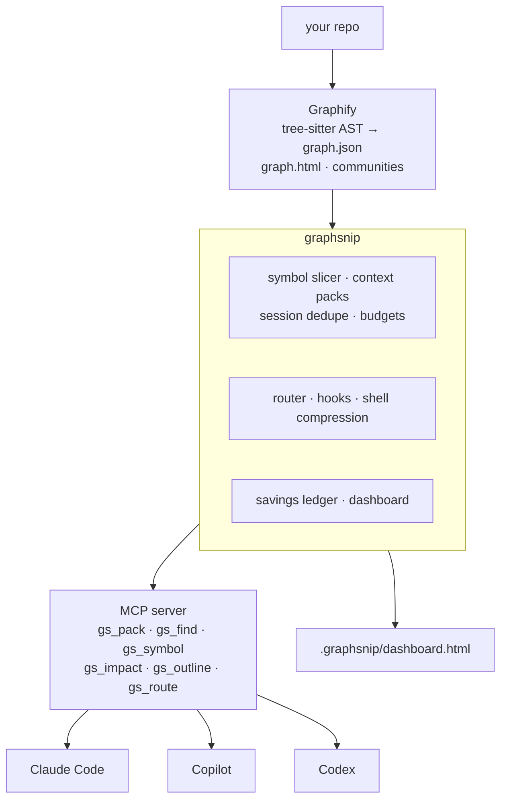
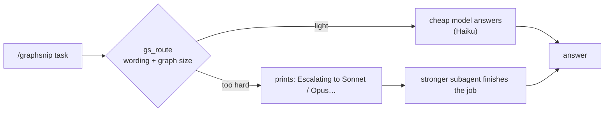

<div align="center">

# graphsnip

**Give your coding agent the exact code it needs, not whole files, and prove the savings.**

A token-saving layer on top of [Graphify](https://github.com/Graphify-Labs/graphify) for **Claude Code**, **GitHub Copilot** and **Codex**.


<br>


<sub>The dashboard <code>graphsnip report</code> writes. Real data from the Flask codebase.</sub>

</div>

---

## At a glance

| | Without a graph | Graphify alone | **Graphify + graphsnip** |
|---|---|---|---|
| What the agent receives | whole files from grep | a map, **no source code** | **the exact code**, ranked and budgeted |
| Tokens for 8 Flask questions | 366,565 | 13,008 (then it must read files) | **17,869** |
| Tokens vs grep + read | baseline | −96% (map only) | **−95%, with code** |
| Questions answered with source | 8 / 8 | symbol named, no code | **8 / 8** |

<div align="center">

</div>

Graphify is excellent at telling an agent *where* things are. graphsnip adds the step after: *hand over just that code*, stop re-sending code the agent already has, and measure what it saved. Baseline here is deliberately realistic: **grep the question's terms and read the top 8 matching files in full**. It is far less than "read the whole repo".

## Try it

**Interactive explorer.** Pick a layer, move the sliders (questions per day, price per million tokens, how many questions go to a cheap model) and watch the monthly numbers change. Starts from the measured Flask and Express results.

- Open [`docs/explorer.html`](docs/explorer.html) in a browser (download it, it is one self-contained file), or
- publish it for your team with GitHub Pages: *Settings → Pages → Deploy from branch → `main` / `docs`*, then visit `https://naubadnithin7.github.io/codegraf/explorer.html`.

<div align="center">

</div>

## Quick start

```bash
pipx install graphsnip            # or: pipx install git+https://github.com/naubadnithin7/codegraf
cd your-repo
graphsnip init                    # build graph, wire up Claude Code / Copilot / Codex, write the dashboard
graphsnip report --open           # savings dashboard (grows as agents use it)
```

No LLM key needed. Everything runs locally: Graphify parses with tree-sitter, graphsnip slices with tree-sitter.

Want a one-command demo on any repo? `graphsnip demo --open` builds the graph, runs a benchmark and opens the dashboard.

## What you get

| | |
|---|---|
| **Exact symbol, not the file** | `gs_symbol` returns one function or class with its callers and callees. Docstrings trimmed, big classes shown as skeletons. |
| **Context packs** | `gs_pack` bundles the ranked code for a whole task under a token budget in one call. |
| **No repeats** | Code the agent already has in this session comes back as a one-line pointer. |
| **Slash commands** | `/graphsnip <question>` in Claude Code and Copilot Chat, `/prompts:graphsnip` in Codex. |
| **Model routing** | Light questions go to a cheaper model, hard ones are handed to a stronger one. Counted only when it really happened. |
| **Hooks** | Claude Code is nudged to use the graph instead of broad `Read` / `grep`. Fail-open, off-switch included. |
| **Shell compression** | `graphsnip run -- pytest` squeezes noisy output and keeps the failure lines. Savings are exact. |
| **Dashboard** | Savings per call, efficiency vs accuracy, routing log, benchmark, and Graphify's interactive graph. |
| **Safe installs** | Idempotent and reversible: `graphsnip install` / `graphsnip uninstall`. Your files are never overwritten. |

## How it fits together



## See it working

<table>
<tr>
<td width="50%">

**Every call, grey vs teal.** Each pair is one tool call: what grep + read would have cost against what graphsnip returned (log scale), with the multiplier on top.


</td>
<td width="50%">

**Same answers, a fraction of the tokens.** On these questions every approach found the symbols, so the difference is what it cost to get there.


</td>
</tr>
</table>

**Graphify's own graph** is embedded in the dashboard (and works offline). Every node is a symbol, colours are detected communities.

<div align="center">

</div>

## Slash commands

`graphsnip install` writes these for you:

| Client | Command | File |
|---|---|---|
| Claude Code | `/graphsnip <question>` and `/graphsnip-deep` | `.claude/commands/` |
| Copilot (VS Code, Local chat) | `/graphsnip <question>` and `/graphsnip-deep` | `.github/prompts/*.prompt.md` |
| Codex | `/prompts:graphsnip <question>` | `~/.codex/prompts/graphsnip.md` (Codex only reads prompts from your home folder; restart Codex) |

```text
/graphsnip how does request routing work
/graphsnip impact Flask.dispatch_request
/graphsnip savings
```

## Model routing

graphsnip cannot switch an agent's model by itself (an MCP server has no such power). What it does is decide, steer, and account for it honestly.



| Client | How the model is switched | Verified by |
|---|---|---|
| **Claude Code** | `/graphsnip` is pinned to the light model; hard tasks hand off to a Sonnet / Opus subagent automatically | session transcripts (`graphsnip usage`) |
| **Codex** | `graphsnip codex "task"` picks the tier and runs `codex exec -m <model>`: a real switch graphsnip performs | the launcher knows the model it passed |
| **Copilot** | `/graphsnip` pinned only if you set `routing.models.copilot.light`; hard tasks need `/graphsnip-deep` | not available |

- **Statuses.** `routed` (running tier matched the decision), `escalate`, `session` (ran on your own model on purpose), `overpowered`, `advisory` (nobody verified which model ran). Dollars are credited **only for `routed`**.
- **Routing saves dollars per token, not tokens.** The token savings above come from the graph alone, and the dashboard keeps the two apart.
- **Prices are editable placeholders** under `routing.prices` in `.graphsnip/config.json`. Put your real ones in before showing a dollar figure. Codex model names go under `routing.models.codex`.

<details>
<summary><b>Codex setup</b></summary>

```json
// .graphsnip/config.json
{ "routing": { "models": { "codex": { "light": "<your light model>", "standard": "<your main model>", "heavy": "<your strongest model>" } } } }
```
```bash
graphsnip codex "where is the auth middleware defined"      # routes, then runs codex exec -m <model>
graphsnip codex --dry-run "refactor session handling"      # print the command only
```
`graphsnip install` also writes matching `graphsnip-light|standard|heavy` profiles into the Codex config.
</details>

## Measured A/B: real tokens and real cost

The dashboard's savings are estimates against a hypothetical baseline. To get **measured** numbers, run the same questions through headless Claude Code with and without graphsnip:

```bash
graphsnip ab --dry-run              # preview: how many sessions, the exact command
graphsnip ab --yes --repeats 2      # run it (spends real usage; capped at $5 total by default)
graphsnip report --open             # "Measured A/B (real runs)" card + headline KPI
```

- Two throwaway copies of your repo: one with graphsnip uninstalled, one with it installed. Your repo is never modified.
- Both arms are read-only, use the same model and prompt, and start a fresh session per run, in shuffled order.
- Cost and tokens are what `claude -p --output-format json` reports (`total_cost_usd`, input, cache and output tokens), so caching and every turn are included.
- Results are medians over repeats; model runs are noisy, so use `--repeats 3` or more for a number you will quote.
- "Found" only checks that the expected symbols appear. The full answers are saved under `.graphsnip/ab/` so you can judge quality yourself.
- Needs the `claude` CLI on your machine. Codex A/B is not implemented yet.

## Commands

<details>
<summary><b>All commands</b></summary>

| Command | What it does |
|---|---|
| `graphsnip init` | build graph, install integrations, benchmark, write dashboard (`--dry-run` previews, writes nothing) |
| `graphsnip demo [--open] [--bundle DIR]` | graph + benchmark + dashboard in one go; `--bundle` makes a shareable folder |
| `graphsnip build [--force]` | build or refresh the Graphify graph (code only, no LLM) |
| `graphsnip pack "task"` | token-budgeted bundle of the code relevant to a task |
| `graphsnip find "question"` | budgeted map: where things live, how they connect |
| `graphsnip symbol Name` | one function or class: exact lines, callers, callees |
| `graphsnip impact Name` | what depends on a symbol |
| `graphsnip outline path` | symbols in a file with line numbers |
| `graphsnip route "task"` | which model tier does this need? (logs the decision) |
| `graphsnip codex "task"` | route, then run `codex exec -m <model for the tier>` |
| `graphsnip run -- <cmd>` | run a command, compress its output, keep the exit code |
| `graphsnip stats` / `report` | savings in the terminal / the HTML dashboard |
| `graphsnip usage` | which models actually answered (from Claude Code transcripts) |
| `graphsnip bench` | offline benchmark: grep+read vs Graphify vs graphsnip |
| `graphsnip ab` | **measured** A/B in headless Claude Code: real tokens and cost, with vs without graphsnip |
| `graphsnip install` / `uninstall` | per-client config (`--clients claude,copilot,codex`) |
| `graphsnip doctor` | check Python, Graphify, tree-sitter, graph freshness, client configs |

Every query command prints `~N tokens returned vs ~M for grep+read → saved P%` to stderr.
</details>

<details>
<summary><b>MCP tools</b></summary>

| Tool | Use it for |
|---|---|
| `gs_pack(task, budget)` | first call for "how does X work" or before a change |
| `gs_find(question, budget)` | locate things (map only) |
| `gs_symbol(name, max_lines, docs)` | read one definition instead of the file |
| `gs_impact(name, depth)` | blast radius before changing a signature |
| `gs_outline(path)` | symbols of a big file before opening it |
| `gs_route(task, running_tier)` | which model tier this task needs |
| `gs_savings()` | tokens saved so far |

A small dependency-free stdio JSON-RPC server (it does not depend on the MCP SDK's changing API). It refreshes a stale graph and records every call in `.graphsnip/ledger.jsonl`.
</details>

<details>
<summary><b>What <code>install</code> writes</b></summary>

Idempotent (run it twice, nothing changes) and reversible (`graphsnip uninstall`). Existing content is preserved: text files get a marked block, JSON is merged.

| Client | Files |
|---|---|
| Claude Code | `.mcp.json`, `.claude/settings.json` (PreToolUse hook), `CLAUDE.md` block, `.claude/commands/graphsnip*.md`, `.claude/agents/graphsnip-{explorer,standard,heavy}.md` |
| Copilot (VS Code) | `.vscode/mcp.json`, `.github/copilot-instructions.md` block, `.github/prompts/graphsnip*.prompt.md` |
| Codex | `.codex/config.toml` (or `~/.codex/config.toml` with `--codex-scope user`), `AGENTS.md` block, `~/.codex/prompts/graphsnip.md` |

Flags: `--allow-tools` pre-approves the read-only tools in Claude Code, `--portable` writes bare `graphsnip` instead of this machine's absolute path (use it before committing configs), `--strict` sets hook mode to strict.
</details>

<details>
<summary><b>Hooks (Claude Code)</b></summary>

Fail-open: any error means "do nothing". Configure in `.graphsnip/config.json` (or `GRAPHSNIP_MODE`).

| Mode | Behaviour |
|---|---|
| `nudge` (default) | adds context: the file's outline for big reads, `gs_symbol("X")` when a grep pattern is a known symbol. Blocks nothing |
| `strict` | denies those same calls with a reason that tells the agent what to call. Literal-string greps and reads with `offset`/`limit` are never blocked |
| `off` | nothing |

`shell_filter: true` additionally rewrites noisy test/build commands to run through `graphsnip run`. It is **off by default** because the rewrite returns an `allow` decision, which skips the permission prompt; it is limited to an allow-list and never touches pipelines or chained commands. POSIX shells only.
</details>

## How the numbers are measured (and what they are not)

- **Baseline per call.** `find` / `pack`: grep the question's terms, read the top 8 matching files in full. `symbol`: read the whole file. `impact`: grep the name, read matching files (cap 10).
- **Counted once.** In a real session, tokens that stay in context are re-sent every turn, so true savings compound. The dashboard does not claim that (the explorer has an optional slider to show it).
- **Quality is checked, not assumed.** A task counts as answered only if the expected symbol appears with its source. That measures whether the right code was delivered, not whether a model's final answer was right.
- **Shell savings are exact** (raw vs compressed output). Token counts elsewhere are `chars / 4` estimates; install `graphsnip[accurate]` for tiktoken.
- **Your repo will differ.** Savings are larger where files are large and lookups are broad. Replace the auto-generated tasks in `.graphsnip/tasks.json` with questions you really ask, then `graphsnip bench`.
- **Dollars** on the main dashboard are `tokens × price per million input tokens`, ignoring output tokens and caching: a list-price estimate. For measured dollars use `graphsnip ab`.

## Known limits

- The hooks and the three client configs follow each tool's documented formats; the MCP server was verified against the official MCP Python client. Run `graphsnip doctor` and a short session in each client before relying on them.
- Symbol slicing is exact for the ~25 languages with tree-sitter grammars installed; elsewhere it falls back to indentation or brace matching.
- The graph only covers what Graphify extracts from code. Docs, PDFs and images need Graphify's semantic pass (needs an LLM key) and are not part of graphsnip's tools.
- Graphify's `graph.html` loads vis-network from a CDN; graphsnip caches it locally so the dashboard works offline (needs internet once).
- Model routing: Copilot cannot hand off to another model, Codex prompt files cannot pin one (use `graphsnip codex`), and the "measured" model mix works only for Claude Code.

## Development

```bash
pip install -e ".[dev]"
pytest -q
```

Publishing: `python -m build && twine upload dist/*` (PyPI), `cd npm && npm publish` (thin npm wrapper that needs Python 3.10+ and pipx or uv).

## License

Apache-2.0. graphsnip is a separate project that calls Graphify (also Apache-2.0) as a library; see `NOTICE`.
